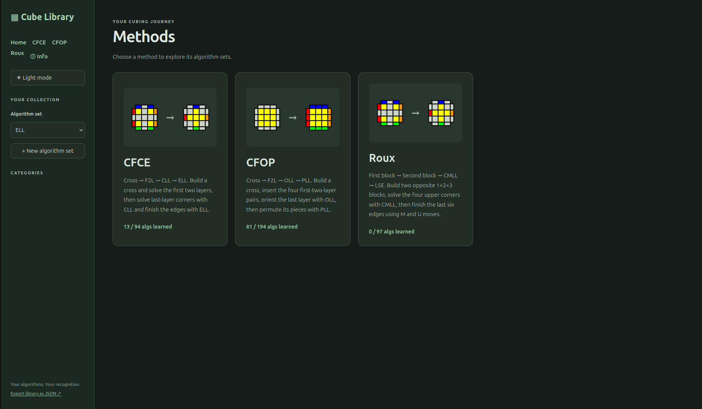
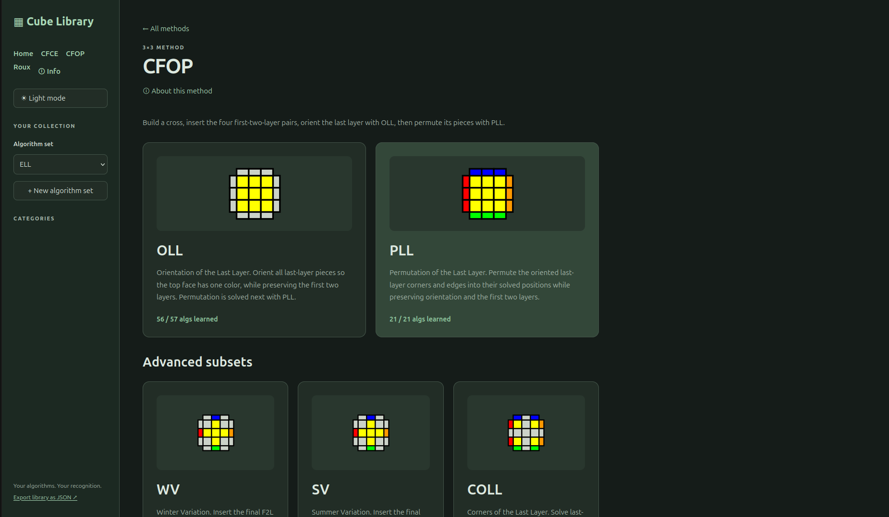
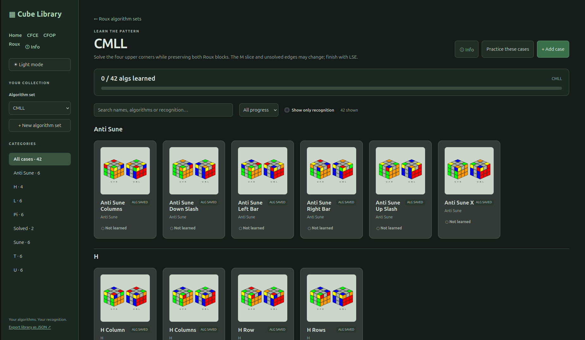
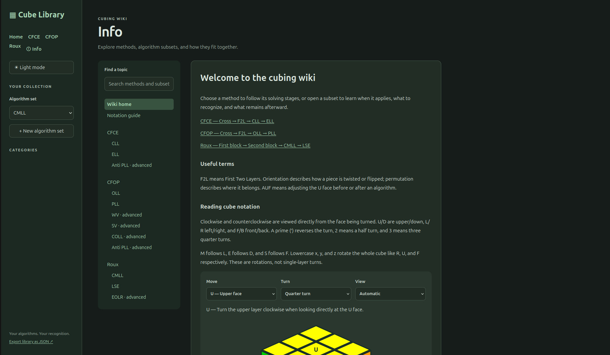

# Cube Library

A local Python Rubik’s cube algorithm database with a browser interface. Organize
cases, draw recognition patterns, track learning progress, and practice with
randomized setups and a keyboard timer. This is a small personal project, mostly
vibe-coded.

The Home page groups the library by **CFCE**, **CFOP**, and **Roux**. Light and dark
themes are available throughout the app; your browser remembers your choice and
follows your system preference until you choose one. The screenshots below show
dark mode and example progress from a personal library.



## Getting started

Requires **Python 3.10 or newer**. From the repository root, create a virtual
environment and install the practice solver:

```bash
python3 -m venv .venv
.venv/bin/python -m pip install -r requirements.txt
.venv/bin/python app.py
```

Your browser opens at <http://127.0.0.1:8765>. Keep the terminal running and press
**Ctrl+C** to stop. If the browser does not open, visit that address yourself.
Choose another port or suppress automatic browser opening with:

```bash
.venv/bin/python app.py --port 8766 --no-browser
```

The library and editor use Python’s standard library and can also run with
`python3 app.py`. The practicer needs `kociemba`, installed by `requirements.txt`,
in the Python environment used to launch the app. Restart the app after updating
Python code or dependencies, and refresh the browser after interface updates.

## Methods and algorithm sets

| Method | Main sets | Advanced subsets |
| --- | --- | --- |
| CFCE | CLL, ELL | Anti PLL |
| CFOP | OLL, PLL | WV, SV, COLL, Anti PLL |
| Roux | CMLL, LSE (EO4A) | EOLR |

**Anti PLL is shared:** both method links open the same database records, so
algorithms, notes, recognition drawings, and progress update under both methods.
Custom sets remain available from Home and the algorithm-set selector. Browser
Back and Forward work between methods, subsets, and wiki topics.



### Bundled cases and sources

A fresh library contains **363 distinct cases**, including the solved ELL skip.
Method totals include their advanced subsets; Anti PLL appears in both CFCE and
CFOP totals but is stored only once.

| Set | Cases | Reference |
| --- | ---: | --- |
| CLL | 42 | [CubePal](https://www.cubepal.app/cubes/3x3x3/stages/cll) |
| ELL | 30 | [Sarah’s Cubing Site](https://sarah.cubing.net/3x3x3/ell), with [SpeedCubeDB alternatives](https://speedcubedb.com/a/3x3/ELL) |
| OLL | 57 | [J Perm](https://jperm.net/algs/oll), cross-referenced with [SpeedCubeDB](https://speedcubedb.com/a/3x3/OLL) |
| PLL | 21 | [J Perm](https://jperm.net/algs/pll), cross-referenced with [SpeedCubeDB](https://speedcubedb.com/a/3x3/PLL) |
| WV | 27 | [J Perm](https://jperm.net/algs/wv), cross-referenced with [SpeedCubeDB](https://speedcubedb.com/a/3x3/WV) |
| SV | 27 | [SpeedCubeDB](https://speedcubedb.com/a/3x3/SV) |
| COLL | 40 | [SpeedCubeDB](https://speedcubedb.com/a/3x3/COLL) |
| CMLL | 42 | [SpeedCubeDB](https://speedcubedb.com/a/3x3/CMLL) |
| LSE / EO4A | 9 | [SpeedCubeDB](https://speedcubedb.com/a/3x3/EO4A) |
| EOLR | 46 | [CubingApp](https://cubingapp.com/algorithms/LSE-EOLR) |
| Anti PLL | 22 | [SpeedCubeDB](https://speedcubedb.com/a/3x3/AntiPLL) |

SpeedCubeDB imports use the first listed community algorithm as primary, except
**SV7**, which uses the second (`R U R'`). Other listed algorithms are retained in
the case description. CLL uses CubePal’s first listed solution, with alternatives
retained. Its diagrams use CubePal’s MIT-licensed geometry; attribution is in
[src/static/cases/cll/LICENSE.md](src/static/cases/cll/LICENSE.md).

WV, OLL, and PLL retain their original J Perm case identities, but their primary
algorithms follow the SpeedCubeDB cross-reference. WV numbering differs between
the sites, so matches are verified by cube state. Descriptions record the source
case and previous primary algorithm where it changed.

ELL diagrams retain their original filename identities as SVGs in
`src/static/cases/ell/`. The solved `ell-epll0.svg` case needs no moves. The 25
non-EPLL cases also have 99 bundled SpeedCubeDB alternatives, adjusted with U
moves where needed for the original diagram orientation. Main ELL algorithms
are preserved.

EO4A covers **edge orientation**, rather than all of LSE. EOLR combines edge
orientation with moving UL and UR to the bottom, after which M2 inserts them.
The EOLR reference omits some mirrored cases; all 46 published cases are included.

Imports and migrations run once, preserving later edits. Source records and
setup states are bundled in `src/data/`; startup does not fetch external sites.
See [rebuilding bundled cases](tools/importers/README.md) for offline import tools.

## Browsing and learning progress

Choose a set, search names, algorithms, or recognition text, and filter by
**Not learned**, **Learning**, or **Learned**. Categories are collapsible and can
contain nested subcategories. Selecting a parent includes its descendants, and
All cases groups the results by parent category.

Click a card’s progress button to cycle its state without opening the case, or
choose **Progress** in the editor. Not learned cards are gray, Learning cards
have an amber background, and the counter reflects the cases shown by the
current category and filters. Progress is saved in your local library.


## Editing cases and recognition drawings

Open a case to edit its main algorithm, description, and recognition notes. The
larger algorithm heading reflects the editable text box. **Save case** saves the
changes and closes the editor.

Enter categories as a path such as `ELL/A/one bar/opposites`. The first part is
the algorithm set; subsequent parts are categories. New sets and categories are
created on save, and existing set names match regardless of capitalization.
Enter only a set name to leave the case uncategorized.

Recognition drawings start from the case diagram, with saved colors and
highlights overlaid. Use the palette to paint, **Highlight** to mark stickers,
**Rotate 90°** to rotate the U layer, and **Reset drawing** to restore the default
colors and remove highlights. **Use on card** uses a case’s drawing as its
thumbnail; **Show only recognition** shows recognition drawings across the grid.

Most sets use a last-layer top view. **CMLL, LSE/EO4A, and EOLR** use two isometric
views, U/F/R and U/B/L, with U facing up in both. These show the upper face and all
four side faces, including lower rows. The solved Roux blocks keep their colors,
and existing gray recognition masks are retained on the unsolved pieces. The
same layout is used in the editor and practice hints. Only visible stickers can
be painted; the underside is not shown.



Drawings are independent recognition aids: painting does not validate cube
solvability, change the setup, or generate a solution. Original diagrams remain
visible in the editor. New cases can use drawings; uploading additional images
through the UI is not implemented.

### Algorithms and setups

For ordinary cases, **Setup from solved** is the inverse of the entered solution.
The picture must correspond to that solution in the same orientation. EOLR uses
a verified case-specific setup because its algorithm solves a stage rather than
the whole cube. Editing its bundled primary algorithm falls back to ordinary
inverse-setup behavior.

Supported notation includes face turns, wide turns (`Rw` or `r`), slices
(`M E S`), cube rotations (`x y z`), primes, doubles, and triple turns (`R3`,
including primed triples). Separate moves with spaces; expand parentheses,
brackets, and repetitions first. Triple turns are preserved in algorithms for
ergonomic notation, while generated setups and practice scrambles use ordinary
single/double turns without `3` notation.

## Practicer

Open **Practice these cases** to train Learning and Learned cases from the current
selection and filters. Not learned cases, blank algorithms, solved skips, and
unsupported notation are excluded. Cases are selected randomly, avoiding an
immediate repeat when possible.

1. Apply the displayed setup to a solved cube.
2. Press and release **Space** to start the timer.
3. Press **any key** to stop. The next scramble appears while your completed time
   stays visible until you start again.


A Learning case solved in **strictly under three seconds** is promoted to Learned.
**DNF — wrong algorithm** marks the most recently completed solve as DNF and sets
that case to Learning, even if it was just promoted. Use it before starting the
next solve.

**Hint** shows the first four moves and recognition drawing for the current case,
in its reference orientation. **Open last case** opens the most recently completed
case over the practicer; closing or saving it returns to practice. **Esc** stops
a running timer or closes practice when stopped. Closing with the close button
during a solve discards that solve. Times last only for the current session;
learning progress is saved.

Practice uses fresh, solver-based alternate scrambles with a random U-layer
angle, checked against the intended state. Ordinary cases derive that target
from the solution; EOLR uses its bundled case state. Standard scrambles use face
turns, while EOLR scrambles can also include a cube rotation to restore the case’s
center orientation. Recognition drawings do not affect scramble generation.

## Cubing wiki and notation guide

Open **ⓘ Info** to browse and search method and subset articles, recognition tips,
related topics, and source links. **About this method** and the subset **Info**
link jump to the relevant article. Wiki articles also link back to case libraries.

The **Notation guide** demonstrates U/D/L/R/F/B, M/E/S, and x/y/z with interactive
3D diagrams. Choose a move and suffix, play or pause, scrub through the turn, or
switch views. Animations start only when requested. The wiki is bundled locally
and does not modify saved cases.



## Storage and backups

The server listens on **127.0.0.1**. Your library is stored in
`data/library.sqlite3`, created on first launch and excluded from Git. Stop the
app before copying that file for backup or restore. Keep the repository’s bundled
data and SVGs when moving the application.

**Export library as JSON** downloads your cases, progress, notes, and drawings.
JSON import is not implemented, so use the SQLite file to restore your library.
Old ELL PNG/SVG database paths migrate to the current location automatically;
legacy `/ELL/...svg` URLs still serve the moved assets.

## Development and checks

Install the test dependencies and run the suite:

```bash
.venv/bin/python -m pip install -r requirements-dev.txt
.venv/bin/python -m unittest discover -s tests -v
```

For browser checks, install Firefox and put `geckodriver` on your PATH:

```bash
RUN_BROWSER_SECURITY_TESTS=1 .venv/bin/python -m unittest discover -s tests -v
```

Without that variable, browser tests are skipped. Tests use temporary databases
and local servers rather than your library. Coverage includes algorithm states,
setups, migrations, SQL injection, XSS, browser interactions, and release logic.
The security checks cover known regression paths rather than constituting a
complete security audit.

### Repository layout

| Path | Purpose |
| --- | --- |
| `app.py` | Application entry point |
| `src/server.py` | HTTP server, storage, and migrations |
| `src/scrambler.py` | Cube simulation and alternate scrambles |
| `src/static/` | Browser interface and SVG case diagrams |
| `src/data/` | Bundled algorithms, provenance, and sticker data |
| `tools/importers/` | Offline source importers and shared diagram utilities |
| `scripts/release.py` | Version and changelog automation |
| `tests/` | Regression suite |
| `data/` | Local SQLite library and backups; ignored by Git |

## Versions and changelogs

The current version is recorded in [VERSION](VERSION), with release notes in
[CHANGELOG.md](CHANGELOG.md). GitHub Actions versions code pushes to `main`;
README-only and screenshot-only pushes do not create a release.

| Commit type | Example | Bump |
| --- | --- | --- |
| Fix, refactor, dependency, or other code change | `fix: preserve learning progress` | Patch |
| Feature | `feat(practice): add hints` | Minor |
| Breaking change | `feat!: replace storage` or a `BREAKING CHANGE:` footer | Major |

For multiple commits, the largest applicable bump wins. The workflow creates a
version tag, `changelog/<version>.md`, and a changelog index entry, then commits
them back to `main`. Pull that generated commit after pushing. Branch pushes and
pull requests do not bump the version until their code reaches `main`.

The workflow needs permission to push commits and tags to `main`. Its own release
commits do not cause another release. Do not manually edit
`.github/release-state.json`; it tracks processed code changes.
