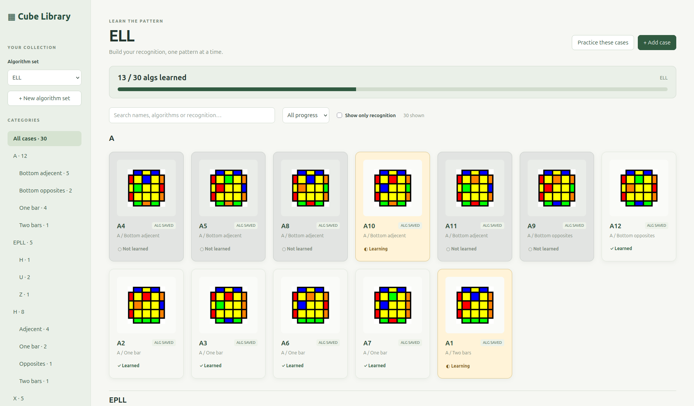
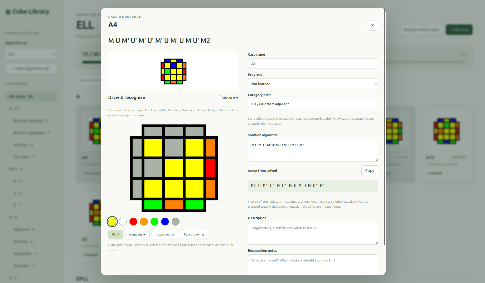
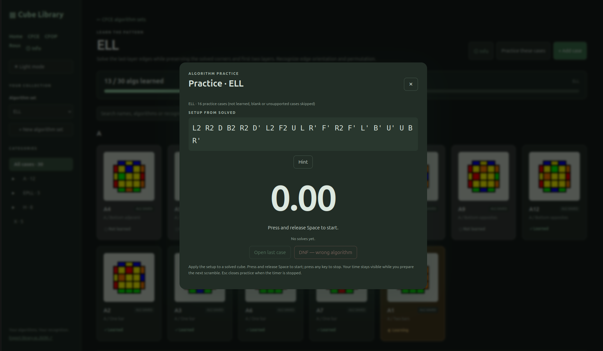

This project is just a little thing for fun. It will be mostly vibe-coded.

# Cube Library

A local Python Rubik’s cube algorithm database with a browser interface. Requires Python **3.10 or newer**. The library works without extra packages; alternate practice scrambles require `kociemba` from `requirements.txt`.

## Versions and changelogs

The project starts at **0.1.0**, tracked in [VERSION](VERSION). GitHub Actions automatically versions code pushes to `main`. The first code push after enabling this workflow publishes 0.1.0; later code pushes bump the version. Documentation-only pushes (including README edits and screenshots) do not create a release.

Use these commit-message prefixes to choose the next version. For a push containing multiple commits, the largest applicable bump wins:

| Change | Commit example | Version bump |
| --- | --- | --- |
| Fix, refactor, dependency, or other code update | `fix: preserve learning progress` | Patch: 0.1.0 → 0.1.1 |
| New feature | `feat(practice): add hints` | Minor: 0.1.1 → 0.2.0 |
| Breaking change | `feat!: replace the storage format` or a `BREAKING CHANGE:` footer | Major: 0.2.0 → 1.0.0 |

Each release creates a `v0.1.0`-style Git tag, a separate Markdown file such as `changelog/0.1.0.md`, and an entry in [CHANGELOG.md](CHANGELOG.md). Release notes list the code commits automatically. The workflow commits these generated files back to `main`; its own changes do not trigger another version bump. After pushing, pull the generated release commit before your next changes. Branch pushes and pull requests do not bump versions until their code reaches `main`.

The workflow needs permission to push commits and tags to `main`. If repository rules block the release bot, allow its release commits or adjust those rules. Do not manually edit `.github/release-state.json`; it tracks the last processed code push. If pushes arrive while a release is running, the next run includes any code commits since the last release.

## Screenshots

**Algorithm library** — Browse sets and nested categories, filter cases, and track your learning progress.



**Case editor** — Edit algorithms and setup scrambles, draw recognition patterns, and add your own notes.



**Practicer** — Train with randomized case scrambles, a keyboard timer, and a DNF button for incorrect solves.



## Running the app

Run from this folder:

```bash
python3 app.py
```

Your browser opens at <http://127.0.0.1:8765>. Keep the terminal running; press Ctrl+C to stop. If the browser does not open, visit that address yourself. Use `python3 app.py --port 8766 --no-browser` to select another port or suppress automatic browser opening.

The solver is installed in this project's `.venv`. To use the practicer, launch with:

```bash
.venv/bin/python app.py
```

For a fresh environment, install `requirements.txt` using that environment's pip. If the existing `.venv` has no pip, the system pip can install into it with `python3 -m pip --python .venv/bin/python install -r requirements.txt`.

- The **Home** page lists supported methods. Open **CFCE** to choose **CLL** or **ELL**, or **CFOP** to choose **OLL** or **PLL**, then browse or practice that subset. **CFOP** includes an Advanced subsets section for **WV (Winter Variation)**, **SV (Summer Variation)**, and **COLL**. **Roux** includes **EOLR** under Advanced subsets. SV includes 27 cases imported from SpeedCubeDB. Home and method links stay in the sidebar; browser Back and Forward work between pages. Custom sets remain available from Home and the algorithm-set selector.
- **WV (27 cases)**, **OLL (57 cases)**, and **PLL (21 cases)** are bundled from [J Perm’s WV](https://jperm.net/algs/wv), [OLL](https://jperm.net/algs/oll), and [PLL](https://jperm.net/algs/pll) lists. The first listed solution is used, with trigger parentheses removed and rotations preserved. Alternatives are retained as listed in each case’s description; some require a different setup or notation. Diagrams are generated locally from the primary solution, with irrelevant last-layer colors masked for OLL and WV. The primary solutions and generated practice scrambles are checked against their cube states. Imports run once and preserve existing cases and progress. The original notation, source order, and URLs are retained in `src/data/jperm_algorithms.json`.
- Main algorithms for those three sets are subsequently cross-referenced with [SpeedCubeDB WV](https://speedcubedb.com/a/3x3/WV), [OLL](https://speedcubedb.com/a/3x3/OLL), and [PLL](https://speedcubedb.com/a/3x3/PLL). The first listed community algorithm becomes the main solution where it differs. WV numbering differs between sites, so matches are verified by cube state rather than number. Your original case names, categories, progress, notes, and edited recognition drawings remain intact; the matching SpeedCubeDB case and previous main solution are recorded in the description. Default diagrams follow the new solution's orientation. This one-time migration updates 27 WV, 38 OLL, and 14 PLL bundled solutions; later user edits are preserved. Exact source matches and setups are recorded in `src/data/speedcubedb_overrides.json`.
- **SV (27 cases)** comes from [SpeedCubeDB’s Summer Variation list](https://speedcubedb.com/a/3x3/SV). The first listed algorithm is primary except **SV7**, which uses the second (`R U R'`). Other solutions are retained in the description. Each selected algorithm is tested against the source setup scramble. Diagrams are generated locally from the primary solution; cases are grouped by the number of oriented top corners. Original source order and setups are recorded in `src/data/sv_algorithms.json`.
- The 30 SVG diagrams in `src/static/cases/ell/` become the initial ELL cases, categorized by their existing filename groups (A, H, X, EPLL).
- The bundled **CLL** set contains all 42 cases from [CubePal’s 3×3×3 CLL page](https://www.cubepal.app/cubes/3x3x3/stages/cll), grouped as PLL, U, T, L, S, AS, P, and H. Each case uses the first listed solution; the other listed solutions are kept in its description (194 algorithms total). The offline diagrams use CubePal’s original MIT-licensed geometry and colors, with irrelevant edges gray and optional PLL arrow overlays omitted. Recognition drawings start from those diagrams. All 194 solutions are checked against the corresponding corner state. The set is imported once without replacing existing CLL cases or changing your ELL data; new CLL cases start Not learned. Diagram attribution is in `src/static/cases/cll/LICENSE.md`.
- Choose a set and category or search the collection. Create additional sets and cases with the corresponding buttons. In a case, type a **Category path** such as `ELL/A/one bar/opposites`, then save. The first part is the algorithm set; the rest is the category hierarchy. New sets and categories are created on save. Existing set names match regardless of capitalization (`ell` uses `ELL`). Enter only a set name to leave the case uncategorized. The sidebar shows collapsible category branches. Click a parent category to select it and expand or collapse its subcategories; use its arrow to expand or collapse without changing the selection. Selecting a parent includes all its descendants. Categories belong to their algorithm set and appear once a case is saved in them.
- Click a case to enter its solution, description, and recognition notes. **Save case** persists all edits, including drawings.
- Set **Progress** to **Not learned**, **Learning**, or **Learned** in a case and click **Save case**. Each card shows its status, the set heading counts learned cases, and the progress filter lets you focus on either group. Existing and new cases default to not learned; progress is saved in SQLite and included in JSON exports.
- Click **Practice these cases** to practice Learning and Learned cases in the current category and filters. Not learned cases are excluded. A Learning case solved in strictly under 3 seconds is automatically marked Learned and saved; existing Learned flags are preserved. Apply the displayed setup to a solved cube, press and release **Space** to start timing, then press **any key** to stop. The next setup appears immediately while the finished time stays visible until the next timer starts. **Hint** reveals the first four solution moves and the recognition drawing for the current scramble, in the case’s reference orientation; it resets when the next scramble loads. **Open last case** shows the most recently completed case without closing practice; close or save the case to return to the same scramble and time. If you solved the case incorrectly, click **DNF — wrong algorithm** before starting the next solve. This marks the most recently completed solve as DNF and saves that case as Learning, including if it was just automatically promoted to Learned. Practice randomly selects cases, avoiding immediate repeats when possible. Blank algorithms, the solved skip, and unsupported notation are excluded. Times are shown for the current practice session only and are not saved. **Esc** stops a running timer or exits practice when stopped; closing with the close button during a solve discards that solve.
- The case editor's setup is generated by inverting your solution. **Practice** instead generates a fresh, solver-based alternate scramble each time, reaching the same case with a random U-layer angle. Scrambles use only face turns and are checked against the intended cube state before being shown. The stored solution defines the target; pictures and recognition drawings do not affect it. Supported solution notation includes face turns, wide turns (`Rw` or `r`), slices (`M E S`), rotations (`x y z`), primes, doubles, and triple turns (`R3`, `U3`, `Rw3`, including primed triples). Triple-turn notation is preserved in saved algorithms and source alternatives because it can describe ergonomic execution; the simulator interprets its equivalent cube movement. Generated setups and practice scrambles use standard single/double turns only, with no triple-turn notation. Separate moves with spaces; expand brackets, parentheses, and repetitions first. Whole-cube orientation is normalized to the centers for practice.
- Recognition drawings start with the colors sampled from the original case image; saved sticker edits and highlights override those defaults. **Reset drawing** restores the case colors and removes highlights. Paint the last-layer top view using the palette: nine top-face stickers surrounded by three stickers on each side, matching the reference image layout. Choose **Highlight** and click stickers to toggle recognition stars. Check **Use on card** to replace the original thumbnail with your drawing. Uncheck it to use the original reference image again. The editor is for free drawing and does not validate cube solvability or generate solutions.
- Original reference images remain visible in case details. New cases can use the drawing tool; importing additional image files through the UI is not implemented.
- ELL algorithms are bundled from [Sarah’s ELL page](https://sarah.cubing.net/3x3x3/ell), matched by exact image filename. The solved `ell-epll0.png` case needs no moves. Initial rotations such as `(y')` are stored as `y'` so setup inversion works. The original website notation and source are retained in `src/data/ell_algorithms.json`. Recognition notes remain ready for your own choices.
- On the first launch with this update, the app fills blank algorithms in existing ELL cases and preserves any algorithms you already entered. This import runs once, so subsequent edits or deliberately cleared algorithms stay unchanged.

Data is stored in `data/library.sqlite3`, created on first launch. Back up that file while the app is stopped to preserve and restore your library. The **Export library as JSON** link downloads a readable snapshot, including drawings; JSON import is not implemented. ELL SVG diagrams stay in `src/static/cases/ell/`, so include that folder when moving or backing up the whole app. Their sticker colors match the original PNGs and can be regenerated from `src/data/ell_stickers.json` with `python3 -m tools.importers.ell_svgs`. Existing PNG image references are migrated automatically without changing saved drawings or progress. The server listens only on your computer at `127.0.0.1`.

Run checks:

```bash
python3 -m unittest discover -s tests -v
node --check src/static/app.js
```

### SQL injection and XSS regression tests

The security tests use a temporary SQLite database and an isolated localhost server; your library is not modified. They check that SQL payloads remain literal values, injected IDs cannot modify unrelated cases, and set lookups cannot be bypassed. They also check that stored payloads are served as JSON with MIME sniffing disabled.

Run the HTTP security tests with:

```bash
.venv/bin/python -m unittest discover -s tests -p test_security.py -v
```

The Firefox test checks that script tags, SVG event handlers, image error handlers, and injected drawing attributes do not execute when rendered in case cards and the editor. Install the development dependencies and have Firefox and `geckodriver` on your PATH, then enable this test explicitly:

```bash
python3 -m pip --python .venv/bin/python install -r requirements-dev.txt
RUN_BROWSER_SECURITY_TESTS=1 .venv/bin/python -m unittest discover -s tests -p test_security.py -v
```

Without `RUN_BROWSER_SECURITY_TESTS=1`, the browser test is reported as skipped; the HTTP tests still run. These are regression tests for the covered inputs and UI paths, rather than a complete security audit.

COLL includes the 40 cases from [SpeedCubeDB](https://speedcubedb.com/a/3x3/COLL), grouped by corner pattern. The first listed community solution is primary; alternatives are retained in the description. Local SVG diagrams mask edge stickers. COLL solves corners while preserving edge orientation, leaving edge permutation. The one-time import preserves later edits and progress.

ELL also includes alternatives from [SpeedCubeDB](https://speedcubedb.com/a/3x3/ELL), matched to the existing 25 non-EPLL cases by cube state. The 99 bundled alternatives include U adjustments where needed for the original diagram orientation. Main algorithms remain unchanged; alternatives appear in each case description. The one-time import preserves notes, drawings, categories, and progress. The source page does not include EPLL or the solved case.

**Roux** is available from Home and the sidebar, with **CMLL** and **LSE** subsets. Build two opposite 1×2×3 blocks, solve the upper corners with CMLL, then solve the last six edges with M and U moves. CMLL includes the 42 cases from [SpeedCubeDB](https://speedcubedb.com/a/3x3/CMLL), grouped by corner pattern. The first community algorithm is primary and alternatives are retained in the description. Local SVGs hide the edges and free M-slice centers. The import runs once and preserves subsequent edits and progress. LSE contains the 9 [SpeedCubeDB EO4A cases](https://speedcubedb.com/a/3x3/EO4A), grouped under EO4A, with the first listed algorithm as primary and the remaining algorithms in the description. These cover edge orientation; UL/UR placement and the final four edges remain separate LSE steps. Diagrams show the upper layer; case names also describe the bottom-edge pattern. Every method and subset now has a description on its navigation card and page.

Roux also contains 46 advanced **EOLR** cases from [CubingApp](https://cubingapp.com/algorithms/LSE-EOLR), grouped by orientation pattern. EOLR combines edge orientation and placement of UL/UR on the bottom; an M2 inserts them afterward. Case names retain the source UL/UR positions, and listed alternatives are kept in the description. Source diagrams have masked stickers, which are completed to legal cube states for native SVGs and playable setups. These cases use verified case-specific setups and random-U practice scrambles, rather than an inverse of the stage algorithm. Editing a primary algorithm falls back to the normal inverse setup behavior. The reference omits mirrored cases; all 46 published cases are included.

Advanced subsets are grouped within their methods: **CFOP → Advanced subsets → WV, SV, COLL** and **Roux → Advanced subsets → EOLR**. EOLR is its own algorithm set; LSE retains EO4A. Existing EOLR cases are moved without resetting progress, notes, drawings, or algorithms. Custom category edits are preserved.

**Anti PLL** is a shared advanced subset under **CFCE** and **CFOP**. Both links open the same 22 database cases, imported from [SpeedCubeDB](https://speedcubedb.com/a/3x3/AntiPLL), including the Pure case. Algorithms, progress, notes, and recognition drawings are shared automatically. The first listed community solution is primary, alternatives are retained in the description, and SVG diagrams are generated locally from the main algorithm. The import runs once and preserves later edits.

Use **ⓘ Info** in the sidebar to open the built-in cubing wiki. Search for methods or subsets, read their solving stages and recognition guidance, follow related-topic and source links, or jump directly to a case library. **About this method** and the subset **Info** link open the relevant article. Wiki content is bundled locally and does not change your saved algorithms or progress.

The wiki **Notation guide** includes interactive 3D sticker diagrams for U/D/L/R/F/B, M/E/S slices, and x/y/z cube rotations. Choose a move and suffix, play or pause the turn, scrub the angle, or switch to a back or bottom view. Animations start only on request; three-quarter-turn notation is demonstrated without changing saved algorithms.

## Repository layout

- `src/`: application server, scramble logic, and static interface.
- `src/data/`: bundled algorithm lists, source records, and diagram sticker data.
- `src/static/cases/`: bundled SVG diagrams.
- `tools/importers/`: offline source importers and shared diagram utilities; see
  [rebuilding bundled cases](tools/importers/README.md) for commands.
- `scripts/release.py`: version and changelog automation used by GitHub Actions.
- `tests/`: algorithm, migration, security, browser, and release checks.
- `data/`: local SQLite library and backups, excluded from Git.

Use the sidebar **Dark mode / Light mode** button to switch themes. Your choice
is saved in this browser and applies across the library, editor, practice timer,
and wiki. Until you choose a theme, the app follows your system preference.
Cube sticker colors retain their original colors in both themes.

CMLL, LSE/EO4A, and EOLR use two complementary isometric cube views: U/F/R and U/B/L, with U facing up in both views. They expose the upper face and all four side faces, including the lower rows. The two solved Roux blocks retain their colors. Recognition drawings and practice hints use the same full-cube layout; existing saved top-layer edits are overlaid without losing notes or progress. Paint and highlight any face in the editor, and use Rotate 90° to rotate only the U layer. Other subsets retain their last-layer diagrams.
